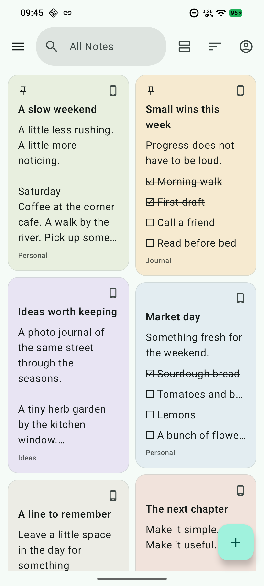
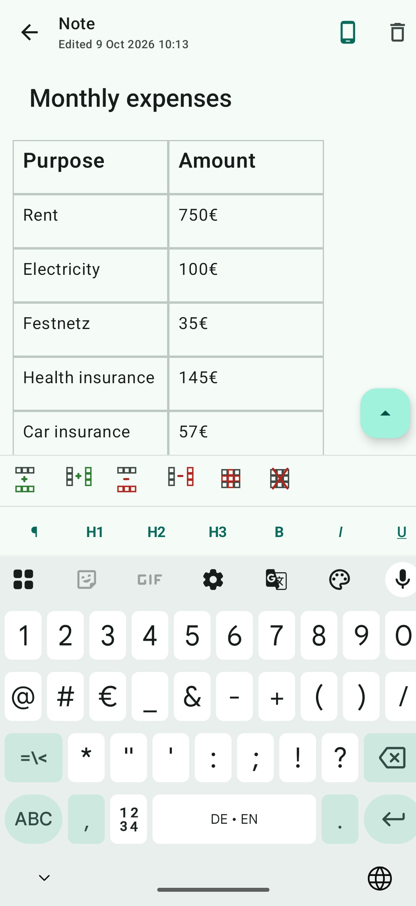
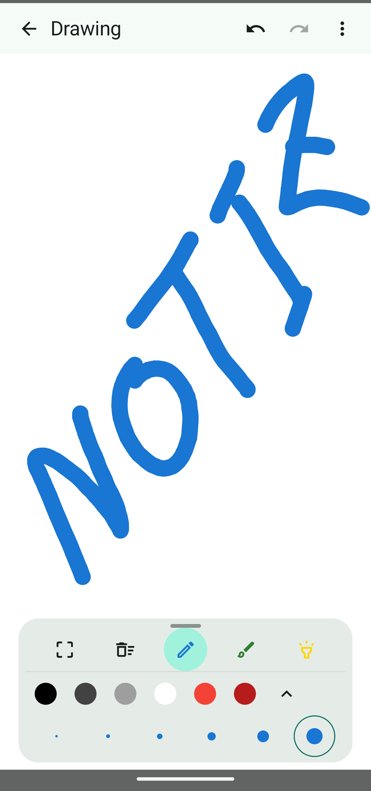
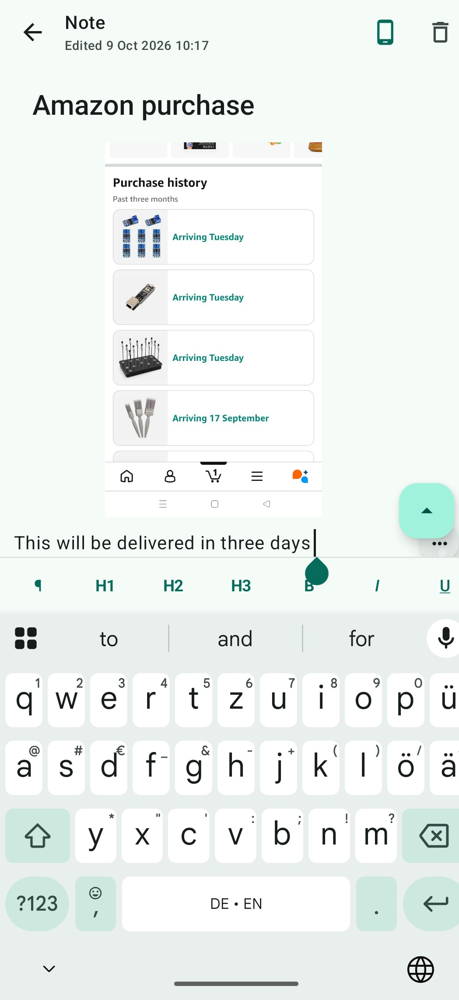
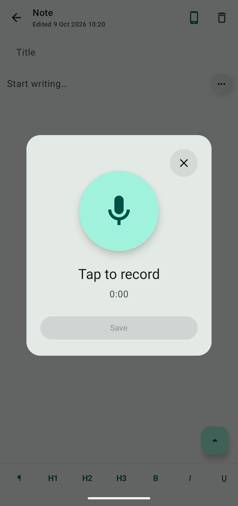
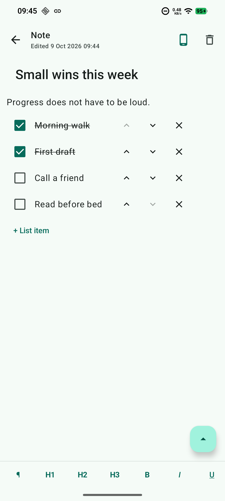

# Notiz for Android

**Private notes, on your terms.**

Notiz is an independent Android note-taking app for the things you want to remember: a passing idea, a shopping list, a sketch, a voice memo, or a plan that works better in a table. It brings different ways of thinking together in one note, with local use available without an account.

This repository contains the **Notiz product website**: a look at the app and its features, screenshots, download availability, the privacy policy, and account-deletion information. The Android application's source code is maintained separately.

## A note can be more than words

| Feature | What you can do |
| --- | --- |
| **Editable tables** | Organize expenses, compare options, or plan your week. Insert rows and columns, delete the ones you no longer need, and format text inside individual cells. |
| **Rich text** | Give notes structure with headings, bold, italic, underline, strikethrough, and text alignment. |
| **Drawing notes** | Sketch ideas and diagrams with drawing tools, colors, and adjustable stroke sizes. |
| **Picture notes** | Keep photos and screenshots alongside the words that explain them. |
| **Audio notes** | Record a thought and save it with your note to listen to later. |
| **Checklists and organization** | Track tasks, label notes, pin important items, search, and archive. |
| **Offline use and optional sync** | Keep notes on your device or choose which notes to synchronize when signed in. |
| **Export and import** | Keep a separate ZIP copy of your notes and attachments, and import it again when needed. |

## A look inside

Real screenshots from Notiz on Android.

<table>
  <tr>
    <th>Notes at a glance</th>
    <th>Editable tables</th>
    <th>Drawing tools</th>
  </tr>
  <tr>
    <td></td>
    <td></td>
    <td></td>
  </tr>
  <tr>
    <th>Pictures with context</th>
    <th>Audio recording</th>
    <th>Everyday checklists</th>
  </tr>
  <tr>
    <td></td>
    <td></td>
    <td></td>
  </tr>
</table>

## Privacy and control

The core app works without an account. Local notes stay on the device unless you choose to add them to Cloud. Notiz has no advertising SDKs or behavioral tracking.

The [privacy policy](privacy-policy.md) describes storage, optional synchronization, permissions, encryption, and retention. The [account-deletion page](account-deletion.md) explains how to request deletion and what happens to local and synchronized data.

## Availability

Notiz is preparing for its public release on **Android 7.0 and later**. Google Play and direct APK downloads are **coming soon**.

The website is under active development. Its privacy notice remains a draft while the remaining operator and retention details are finalized.

## About the website

Built with **Jekyll**, Markdown, and SCSS, using a customized **Minima** theme. The site includes responsive layouts, light and dark color schemes, and screenshots of the actual app. It is compatible with GitHub Pages and contains no added analytics or third-party font requests.

## Creator and credits

Notiz is independently created and maintained by **[nazmos-sakib](https://github.com/nazmos-sakib)**.

- **Product and app:** nazmos-sakib.
- **Website development:** nazmos-sakib, with assistance from OpenAI Codex.
- **App screenshots:** captured from Notiz on Android and supplied by the project creator.
- **Site foundation:** [Jekyll](https://github.com/jekyll/jekyll) and the [Minima theme](https://github.com/jekyll/minima), both distributed under the MIT License. Their notices are preserved in [THIRD_PARTY_NOTICES.md](THIRD_PARTY_NOTICES.md).

Third-party names and content visible within screenshots belong to their respective owners; their appearance does not imply endorsement.

## Rights and licensing

**© 2026 nazmos-sakib. All rights reserved.**

This repository is publicly viewable, but no general reuse license is granted for the creator’s original website code or content. See [LICENSE](LICENSE) for the scope and contact the creator for permission requests.

Jekyll, Minima, and other third-party material retain their own licenses and rights. This repository does not grant a license to the separately maintained Android application.

## Contact

Questions, feedback, and privacy requests: [s.nazmos.sakib@gmail.com](mailto:s.nazmos.sakib@gmail.com).
